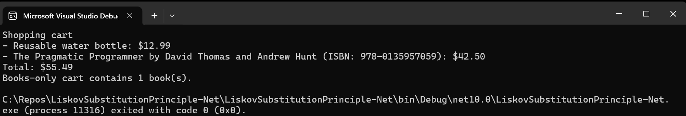

# Liskov Substitution Principle: Online Shop Example

This .NET 10 console app demonstrates the Liskov Substitution Principle (LSP) with a shop's `Product` type and its specialized `Book` subtype.

## Valid substitution: `Book` for `Product`

In `LiskovSubstitutionPrinciple-Net/Program.cs`, `shoppingCart` is a `List<Product>` containing both a regular `Product` and a `Book`. `PrintReceipt(IEnumerable<Product>)` processes them using the shared product contract. For the book, `GetDescription()` calls the `Book` override.

The book works wherever a product is expected, while adding author and ISBN information. That is the valid substitution example.

## Books-only collection

`booksOnlyCart` is a `List<Book>`. The attempted insertion of a regular `Product` is shown in a comment because uncommenting it causes a compile-time error: `List<Book>.Add` requires a `Book`.

This is not an LSP violation. `List<Book>` is not a subtype of `List<Product>`, so it is never substituted where a general product collection is required. An LSP violation would require a subtype of a general abstraction that breaks behavior promised by that abstraction—for example, a general cart that accepts any `Product` and a derived cart that rejects non-books.

## Run

Run the `LiskovSubstitutionPrinciple-Net` project to see the mixed product/book receipt and the number of books in the books-only collection.

